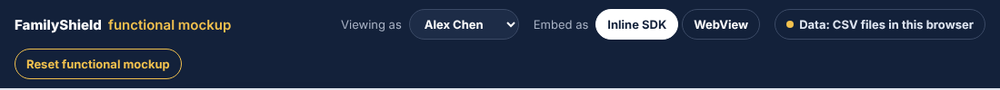
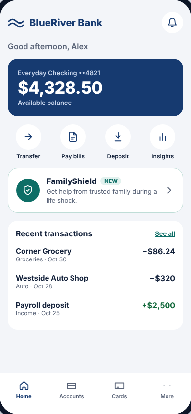
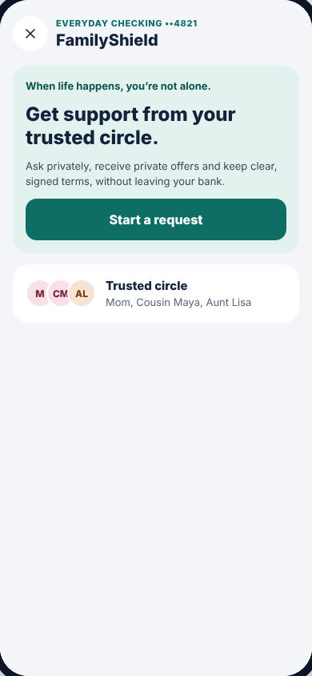
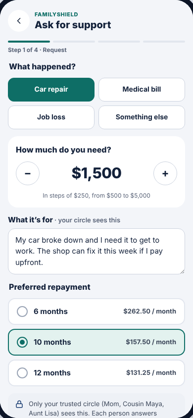
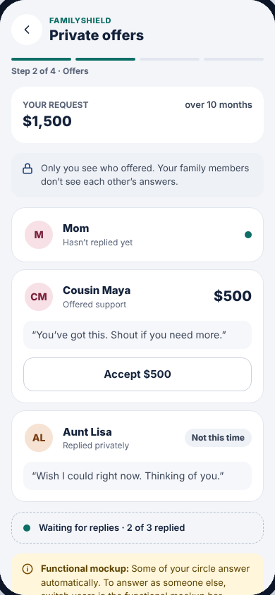
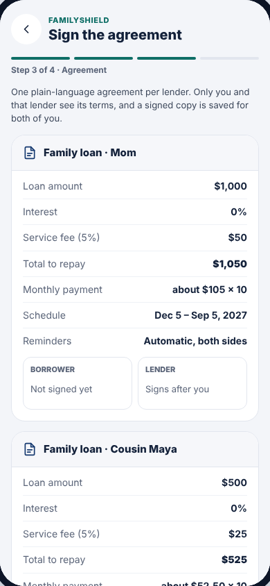
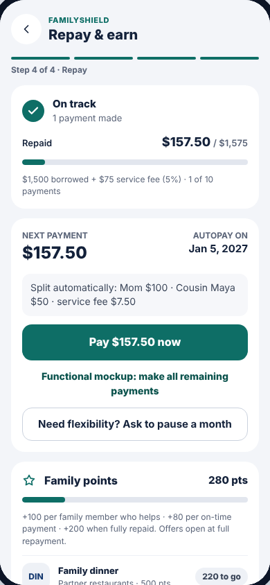
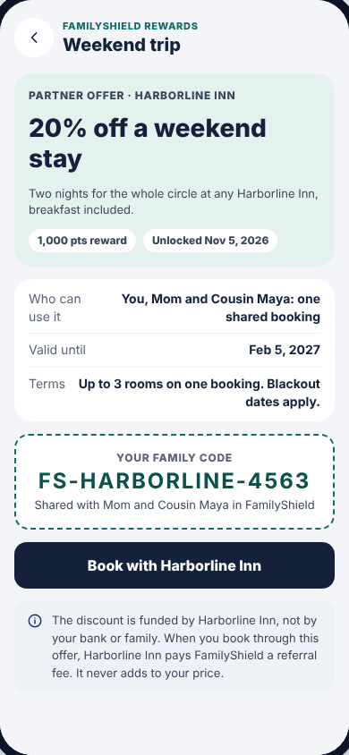
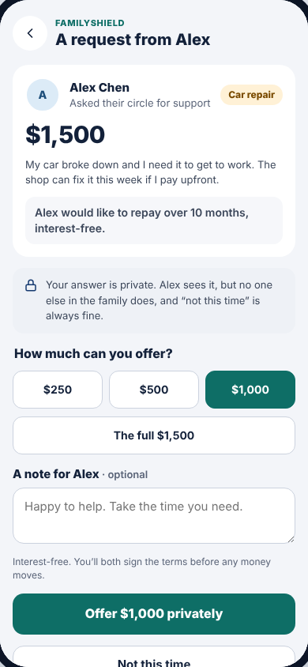

# Screen by screen

Each page below shows one screen, then explains **which file draws it**,
**where every number comes from**, and **how to make common changes**.

| | Screen | What it is | Main file |
| --- | --- | --- | --- |
|  | [Functional mockup bar](top-bar.md) | The dark testing bar above everything | `apps/demo-bank/src/App.tsx` |
|  | [Bank home](bank-home.md) | BlueRiver Bank's home screen, with the FamilyShield card | `apps/demo-bank/src/BankHome.tsx` |
|  | [FamilyShield hub](hub.md) | The first FamilyShield screen, for borrowers and lenders | `packages/sdk/src/ui/screens/Hub.tsx` |
|  | [Step 1 · Request](request.md) | Ask for support: reason, amount, plan | `packages/sdk/src/ui/screens/Request.tsx` |
|  | [Step 2 · Private offers](offers.md) | Replies from family; accept offers | `packages/sdk/src/ui/screens/Offers.tsx` |
|  | [Step 3 · Agreement](agreement.md) | One signed agreement per lender | `packages/sdk/src/ui/screens/Agreement.tsx` |
|  | [Step 4 · Repay & earn](repay.md) | Payments, pause, points, rewards list | `packages/sdk/src/ui/screens/Repay.tsx` |
|  | [Partner reward](reward.md) | One unlocked partner offer and its code | `packages/sdk/src/ui/screens/Reward.tsx` |
|  | [Lender screens](lender.md) | What Mom sees: answer a request, sign, approve a pause, follow repayments | `packages/sdk/src/ui/screens/Lender.tsx` |

## Pieces every FamilyShield screen shares

Before diving in, know these files. Every screen uses them.

| File | What's in it | Change it to… |
| --- | --- | --- |
| `packages/sdk/src/ui/App.tsx` | The **router**: decides which screen to show. Borrower screens follow the loan's real status, so a request that's already signed always opens on the Agreement step | Add a new screen |
| `packages/sdk/src/ui/kit.tsx` | Shared building blocks: `Screen` (header with back/close button), `Steps` (the 4-step bar and its labels), `Button`, `Notice` (grey info boxes), `DemoHint` (yellow "Functional mockup:" boxes), `Avatar`, `Progress`, `Terms` (label/value tables) | Restyle all buttons, rename the steps, change avatar colors |
| `packages/sdk/src/ui/styles.ts` | All CSS for the module (`fs-…` classes) | Spacing, fonts, corner radius, card styles |
| `packages/sdk/src/theme.ts` | Brand colors (`brand`, `brandSoft`, `night`, `accent`, …) | Re-color the whole module at once |
| `packages/sdk/src/ui/icons.tsx` | Small line icons (back, lock, star, …) | Add or change an icon |
| `packages/sdk/src/ui/context.tsx` | Loads everything a screen needs from the back-end and provides `useFs()`: `data`, `api`, `run`, `go`, `back`, `nameOf` | Load extra data for every screen |

### Where screens get their data

Every FamilyShield screen reads from `data`, which `context.tsx` loads from the
back-end:

| `data.…` | Contains | Comes from |
| --- | --- | --- |
| `config.rules` | Fee %, request limits, terms, points, pauses | `data/settings.csv` |
| `config.rewards` | The partner rewards | `data/rewards.csv` |
| `profile.me`, `profile.circle` | Who's signed in, and their trusted circle with nicknames | `data/people.csv`, `data/circles.csv` |
| `myLoan` | The signed-in person's own request/loan, everything about it | `loans.csv`, `offers.csv`, `agreements.csv`, `installments.csv`, … |
| `incoming` | Requests from family the signed-in person was asked to help with (only their own part of each) | Same files, filtered for privacy |

`nameOf(id)` turns an id like `mom` into what *this* person calls them ("Mom"),
using the `nickname` column of `circles.csv`.
