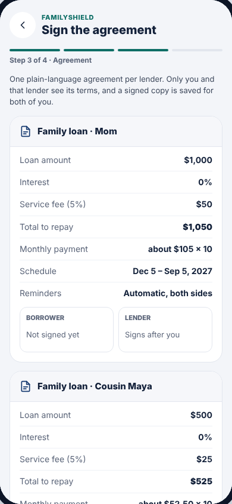

# Step 3 · Agreement

One plain-language agreement per lender. The borrower signs all of them at
once; then each lender signs theirs. Money moves when everyone has signed.

**Drawn by:** `packages/sdk/src/ui/screens/Agreement.tsx`. Two components:
- `Agreement`: the whole screen
- `AgreementDoc`: one agreement card. It's reused on the lender's
  sign screen ([Lender screens](lender.md))

**Shown when:** the loan is `collecting` and you tapped Review agreement
(preview + sign), or the loan is `signing` (waiting for lenders).

 

## What's on it → where it comes from

| Part | Code | Data / rule |
| --- | --- | --- |
| Card title "Family loan · Mom" | `AgreementDoc`, `fs-doc-head` | lender's nickname |
| Loan amount | `Terms` rows in `AgreementDoc` | accepted offer amount |
| Interest 0% | same | `interest_rate_percent` in `agreements.csv` (always 0 today) |
| **Service fee (5%) $50** | same | `fee_rate_percent` in `settings.csv`; calculated by `draftAgreements()` → `feeFor()` in `packages/core` |
| **Total to repay** $1,050 | same | loan amount + fee |
| Monthly payment, Schedule | same | `months`; first payment one month after funding |
| Borrower / Lender signature boxes | `fs-sigs` | `borrower_signed_at`, `lender_signed_at` in `agreements.csv` |
| "Total to repay (incl. $75 fee) $1,575" | `Agreement`, below the cards | sum of all agreements |
| **Sign 2 agreements** | `Agreement` | see below |

Before signing, the cards are a *preview* calculated on the fly
(`draftAgreements`). After signing they're read from `agreements.csv`.

## What "Sign" does

1. `api.signAsBorrower(loanId)` → `signAsBorrower` in `service.ts` → `signAsBorrower` in `packages/core/src/loan.ts`
2. Creates one row per lender in `agreements.csv`, marks unanswered offers `expired`, sets the loan to `signing`.
3. Lenders listed with `auto_sign = yes` in `auto_replies.csv` sign 1.5 s later.
   Others (Mom) sign from their own [lender screen](lender.md).
4. When the **last** lender signs, `activate()` in `loan.ts` builds the
   payment schedule (`buildSchedule`), awards help points, and sets the loan to
   `active`. `settle()` in `service.ts` moves the money: rows in `transactions.csv`.

## Common changes

- **Add a line to the agreement** (e.g. "Late payment: reminder after 3 days"):
  add a `['Label', 'value']` pair to the `rows` list in `AgreementDoc`.
- **Change the signature font:** `.fs-sig .ink` in `packages/sdk/src/ui/styles.ts`.
- **Change the fee:** `fee_rate_percent` in `data/settings.csv`. It applies to
  new agreements; signed ones keep their fee.
