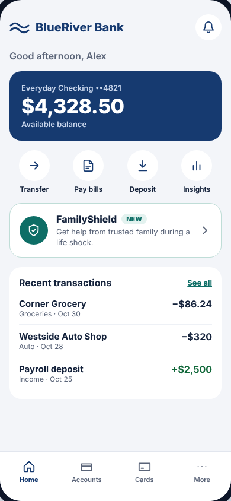

# Bank home (BlueRiver Bank)

The pretend bank's home screen. Everything here belongs to **the bank**, except
the FamilyShield card, which is the bank's doorway into our module.

**Drawn by:** `apps/demo-bank/src/BankHome.tsx` (component `BankHome`).
**Data loaded by:** `useBankData` in `apps/demo-bank/src/App.tsx`.
**Styles:** `apps/demo-bank/src/styles.css` (`.bank`, `.balance`, `.quick`,
`.fs-entry`, `.txns`, `.tabs`).

 

## What's on it → where it comes from

| Part | Code | Data |
| --- | --- | --- |
| "BlueRiver Bank" logo and bell | top of `BankHome` (`bank-top`) | — |
| "Good afternoon, Alex" | `greeting` | `first_name` in `data/people.csv` |
| Account name ("Everyday Checking ••4821") | `balance` section | `account_label` in `people.csv` |
| **Balance** ($4,328.50) | `balance-amount` | `opening_balance` in `people.csv` **plus** every row for this person in `transactions.csv` (calculated by `account()` in `packages/service/src/service.ts`) |
| Transfer / Pay bills / Deposit / Insights | the list inside `<nav className="quick">` | — (decorative) |
| **FamilyShield card** | `fs-entry` button | Subtitle chosen by `entrySubtitle()` at the top of `BankHome.tsx`, from the person's loan and family requests |
| Recent transactions | `transactions` list | FamilyShield rows come from `transactions.csv`; Corner Grocery etc. are fixed examples in `BASE_TRANSACTIONS` |
| Home / Accounts / Cards / More | `<nav className="tabs">` | — (decorative) |

## The FamilyShield card's subtitle

`entrySubtitle()` picks one message, checking in this order:

1. Someone in my family is waiting on me → **"Your family needs you · 1 to review"** (with a number badge)
2. I have an open request → "collecting private offers" / "Waiting for everyone to sign" / "Next family payment $157.50 · Dec 5"
3. My loan is repaid → "Fully repaid. Your family rewards are ready."
4. Nothing yet → "Get help from trusted family during a life shock." (with a **NEW** badge)

## Common changes

- **Change someone's balance:** edit `opening_balance` in `data/people.csv`.
  Save; it updates on the next refresh.
- **Change the example transactions:** edit `BASE_TRANSACTIONS` at the top of `BankHome.tsx`.
- **Reword the FamilyShield card:** edit the strings in `entrySubtitle()`.
- **Change the bank's colors:** the variables at the top of `styles.css`
  (`--navy` is the bank's blue, `--fs` is the FamilyShield teal used on the card).

## What tapping the card does

`onOpenFamilyShield` → `App.tsx` sets `open` → `FamilyShieldSheet.tsx` slides up
and starts the module, either **inline** (`mountFamilyShield(...)`) or as a
**WebView** (`<iframe src="./embed.html">`), depending on the top bar.
