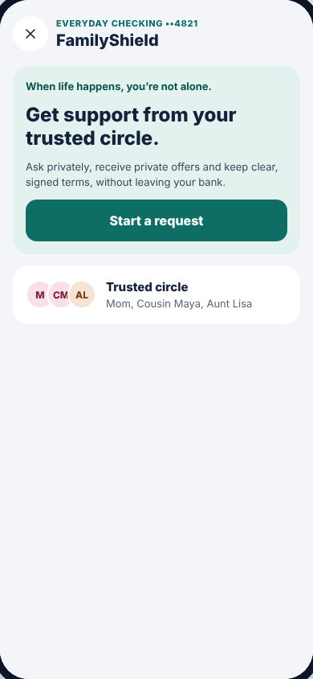
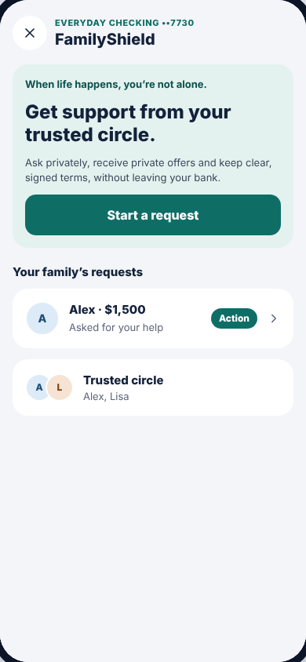

# FamilyShield hub

| As Alex (nothing started yet) | As Mom (Alex asked her for help) |
| --- | --- |
|  |  |

The first screen of the FamilyShield module, and the one the ✕ button closes.
It changes depending on what's going on for the signed-in person.

**Drawn by:** `packages/sdk/src/ui/screens/Hub.tsx` (component `Hub`).

## What's on it → where it comes from

| Part | When it shows | Code (in `Hub.tsx`) | Data |
| --- | --- | --- | --- |
| Header: "EVERYDAY CHECKING ••4821 / FamilyShield", ✕ | Always | `<Screen … root>` (the ✕ closes the module) | `account_label` in `people.csv` |
| Teal card: "YOUR REQUEST $1,500" or "ACTIVE FAMILY LOAN $1,575" | You have a request or loan | `MyLoanCard` | `myLoan` (`loans.csv`, `offers.csv`, `installments.csv`) |
| Mint card: "Get support from your trusted circle." + **Start a request** | You have no open request | the `<section className="fs-card soft">` block | — |
| **Your family's requests** list | Someone asked you for help | the `incoming.map(...)` block; each line's text comes from `incomingStatus()` | `incoming` |
| "Action" badge | That request needs you (reply, sign, or pause approval) | `incomingStatus()` returns `action: true` | — |
| Trusted circle | Always | the `Avatar` row | `circles.csv` (+ `nickname`) |
| Private offers / Agreements & repayment | You have a request or loan | two `fs-list-btn` buttons | `myLoan` |
| Family points | Your loan has points | last `<section>` | `points` in `loans.csv` |

## Where each tap goes

`go({ name: … })` opens a screen. The router in `packages/sdk/src/ui/App.tsx`
then shows the right step for the loan's real status:

| Tap | Opens |
| --- | --- |
| Start a request | [Request](request.md) |
| Your request card / Private offers | [Offers](offers.md) → or [Agreement](agreement.md) / [Repay](repay.md) if already further along (`borrowerRoute()`) |
| A family request | [Lender screens](lender.md) (respond, sign, approve pause, follow repayment) |

## Common changes

- **Reword the welcome card:** edit the text in the `fs-card soft` section.
- **Change the "Your family's requests" status lines** (e.g. "Asked for your help"): edit `incomingStatus()`.
- **Hide the points card until there are points:** it already checks `myLoan.points > 0`; change that condition.
- **Who's in the trusted circle:** `data/circles.csv`, not code.
