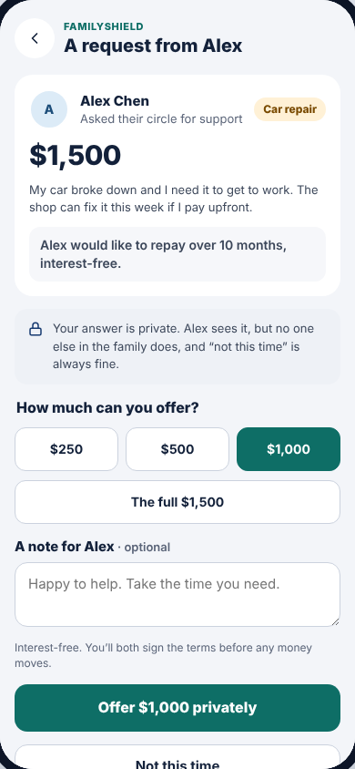
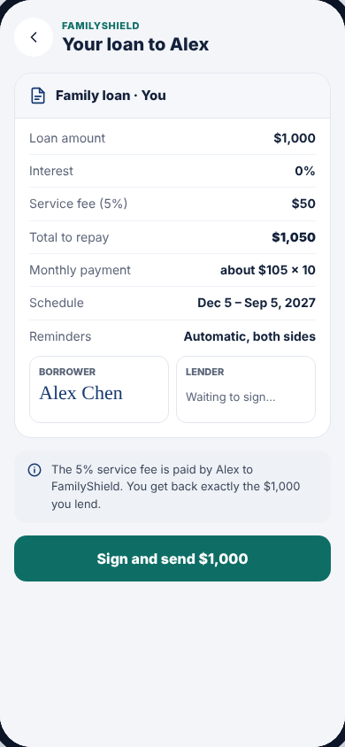

# Lender screens (what Mom sees)

| Answer a request | Sign the agreement |
| --- | --- |
|  |  |

To see these, switch **Viewing as** to **Grace Chen** (Mom) after Alex has sent
a request, open FamilyShield, and tap Alex's line under **Your family's
requests** on the [hub](hub.md).

**Drawn by:** `packages/sdk/src/ui/screens/Lender.tsx`, which has three components:

| Component | Screen | Shown when |
| --- | --- | --- |
| `Respond` | "A request from Alex": answer privately | The request is still collecting answers |
| `LenderLoan` | "Your loan to Alex": sign, approve a pause, follow repayments | You're a lender on the loan (after Alex signed) |
| `RequestSummary` | The card at the top of `Respond` | Inside `Respond` |

The router in `packages/sdk/src/ui/App.tsx` picks between `Respond` and `LenderLoan`.

## Privacy: what a lender can see

A lender only ever receives **their own** offer, agreement, payments and pause
answer. Other family members' answers are removed on the back-end by
`redactForLender()` in `packages/service/src/service.ts`, *before* anything
reaches the screen. Never rely on the screen to hide private data.

## `Respond`: answer a request

| Part | Code | Data |
| --- | --- | --- |
| Alex Chen, "Car repair" tag, $1,500, purpose | `RequestSummary` | `loans.csv`; tag text from `REASON_LABEL` |
| "Alex would like to repay over 10 months, interest-free." | `RequestSummary` | `months` |
| Amount chips $250 / $500 / $1,000 / The full $1,500 | `presets` in `Respond` | Fixed in code; the "full" chip appears for requests over $1,000 |
| Note box | `<textarea id="fs-note">` | saved in `note` (max 280 characters) |
| **Offer $1,000 privately** / **Not this time** | `api.respond(...)` → `respondToRequest` in `core/src/loan.ts` | `offers.csv` row: `status`, `amount`, `note`, `responded_at` |
| Mint "You offered $1,000" card | after answering | — |

## `LenderLoan`: sign, pause, repayments

| Part | Code | Data |
| --- | --- | --- |
| Agreement card | reuses `AgreementDoc` from `Agreement.tsx` | the lender's row in `agreements.csv` |
| "The 5% service fee is paid by Alex…" | `<Notice>` | fee from the agreement |
| **Sign and send $1,000** | `api.signAsLender` → `signAsLender` in `core/src/loan.ts` | `lender_signed_at`; the last signature funds the loan |
| "Repaid to you $100 / $1,000" + bar | `lenderSummary()` in `core/src/selectors.ts` | this lender's rows in `installment_splits.csv` |
| "Alex asked to pause one month" + Approve / Not this time | `api.respondToPause` → `respondToPause` | `pause_answers.csv` |

## Common changes

- **Different amount chips:** edit `presets` in `Respond` (amounts are in
  cents: `50_000` = $500).
- **Reword the privacy note:** search `Your answer is private` in `Lender.tsx`.
- **Show lenders the borrower's next due date on the hub:** extend
  `incomingStatus()` in `Hub.tsx`. The data is already in `loan.schedule`.
