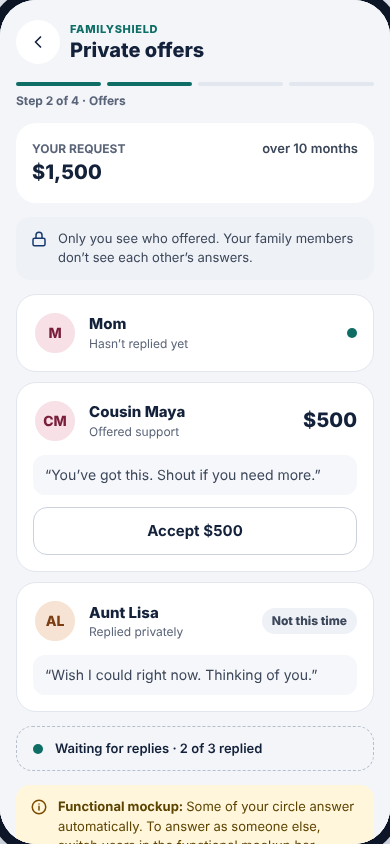

# Step 2 · Private offers

The borrower watches family members reply and accepts the offers they want.
Only the borrower sees who offered what.

**Drawn by:** `packages/sdk/src/ui/screens/Offers.tsx` (component `Offers`).
**Shown when:** the loan's status is `collecting` (see `BorrowerStep` in
`packages/sdk/src/ui/App.tsx`).

 

## What's on it → where it comes from

| Part | Code (in `Offers.tsx`) | Data |
| --- | --- | --- |
| "YOUR REQUEST $1,500 over 10 months" | first `<section>` | `amount`, `months` in `loans.csv` |
| One card per family member | `loan.offers.map(...)` | one row per person in `offers.csv` |
| Name ("Cousin Maya") | `nameOf(offer.memberId)` | `nickname` in `circles.csv` |
| Status line ("Offered support", "Hasn't replied yet") | the `offer.status === …` checks | `status` column: `pending`, `offered`, `declined`, `expired` |
| Amount and quote | `offer.amount`, `offer.note` | `amount`, `note` in `offers.csv` |
| **Accept $500** / **Accepted ✓** | the `<Button>` inside each card | `accepted` in `offers.csv` |
| "Waiting for replies · 2 of 3 replied" | `pending.length > 0` block | — |
| Yellow "Functional mockup:" hint | `<DemoHint>` | Only shown in the functional mockup |
| "Accepted $1,500 of $1,500" | `acceptedTotal()` from `packages/core/src/loan.ts` | — |
| **Review agreement** / **Cancel request** | bottom buttons | — |

## Who replies automatically?

`data/auto_replies.csv`. With the shipped data, Cousin Maya offers $500 after
2.5 seconds and Aunt Lisa declines after 4.5 seconds. Mom isn't listed, so she
waits for a real person: switch **Viewing as** to Grace Chen and answer as her
(see [Lender screens](lender.md)).

The timing logic is `automate()` in `packages/service/src/service.ts`.

## What the buttons do

| Button | API call → service → rule | Saved in |
| --- | --- | --- |
| Accept / Accepted ✓ | `setOfferAccepted` → `setOfferAccepted` in `core/src/loan.ts` (refuses if accepted offers would exceed the request) | `accepted` in `offers.csv` |
| Review agreement | just opens [Agreement](agreement.md); nothing is saved | — |
| Cancel request | `cancelRequest` → status `cancelled` | `status` in `loans.csv` |

## Common changes

- **Change Maya's or Lisa's behavior, or make Mom automatic too:** edit
  `data/auto_replies.csv` (add a row for `mom`).
- **Reword "Not this time":** search for it in `Offers.tsx`.
- **Allow accepting more than requested:** remove the check in
  `setOfferAccepted` in `packages/core/src/loan.ts`, and update its test in
  `packages/core/test/loan.test.ts`.
