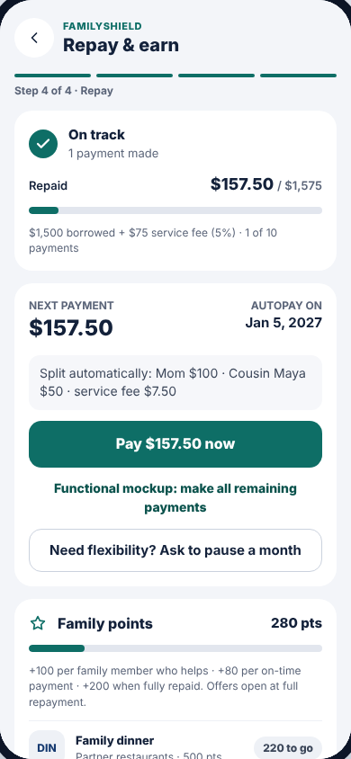
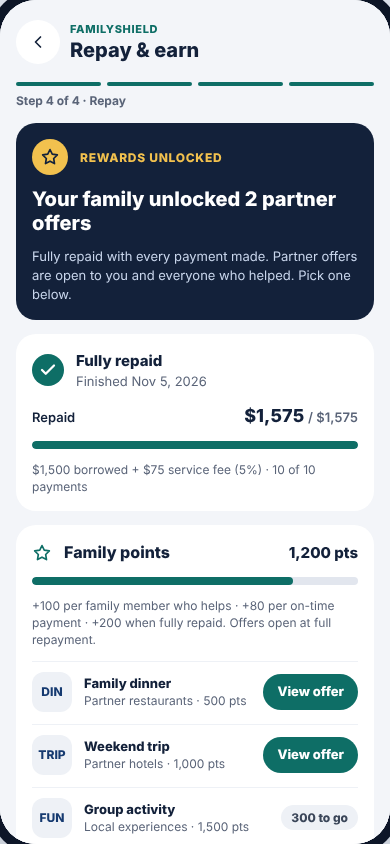

# Step 4 · Repay & earn

| While repaying | Fully repaid |
| --- | --- |
|  |  |

The borrower's loan after everyone has signed: progress, next payment, a
one-month pause, family points and partner rewards.

**Drawn by:** `packages/sdk/src/ui/screens/Repay.tsx` (component `Repay`).
**Shown when:** the loan is `active` or `repaid`.

## What's on it → where it comes from

| Part | Code (in `Repay.tsx`) | Data / rule |
| --- | --- | --- |
| Dark "REWARDS UNLOCKED" banner | `repaid ? …` at the top | loan `status = repaid` |
| "On track / Fully repaid", Repaid $157.50 / $1,575, progress bar | the `repaymentSummary(loan)` card | `repaymentSummary()` in `packages/core/src/selectors.ts`, from `installments.csv` and `agreements.csv` |
| "$1,500 borrowed + $75 service fee (5%)" | same card | fee from `agreements.csv` |
| NEXT PAYMENT $157.50, AUTOPAY ON date | the `next` card | the first unpaid row in `installments.csv` |
| "Split automatically: Mom $100 · Cousin Maya $50 · service fee $7.50" | `next.parts` | `installment_splits.csv` |
| **Pay $157.50 now** | `pay()` | see below |
| "Functional mockup: make all remaining payments" | `payAll()`, only when `demo` is on | — |
| **Ask to pause a month** / pause status | the `pause` blocks | `max_pauses` in `settings.csv`; `pauses.csv`, `pause_answers.csv` |
| Family points, "+100 per family member who helps…" | points card | `points` in `loans.csv`; values from `points_per_…` in `settings.csv` |
| Reward rows: "220 to go" / "At full repayment" / **View offer** | `REWARDS.map(...)` | `data/rewards.csv`; status from `rewardStatus()` in `packages/core/src/rewards.ts` |

## What the buttons do

| Button | Rule (in `packages/core/src/loan.ts`) | Saved in |
| --- | --- | --- |
| Pay now | `recordPayment`: marks the next installment paid; +on-time points if paid by the due date; on the last one sets `repaid` and adds the completion bonus. `settle()` in `service.ts` moves the money | `installments.csv` (`paid_at`, `on_time`), `points_log.csv`, `loans.csv`, `transactions.csv` |
| Ask to pause a month | `requestPause`: every lender must approve (`respondToPause`); if all approve, every unpaid due date moves one month later | `pauses.csv`, `pause_answers.csv`, `installments.csv` |
| View offer | opens [Partner reward](reward.md) | — |

## Rewards unlock rule

A reward is **available** only when **both** are true: the loan is fully
repaid, **and** the family's points ≥ `points_needed`. The single place this
rule lives is `rewardStatus()` in `packages/core/src/rewards.ts`.

## Common changes

- **Points values, max pauses:** `data/settings.csv`.
- **Rewards (names, partners, thresholds):** `data/rewards.csv`.
- **Unlock rewards before full repayment:** change `rewardStatus()` in
  `rewards.ts`, then update the test "only unlock at full repayment" in
  `packages/core/test/loan.test.ts`. Tests are how we write rules down.
- **Reword the pause explanation:** search for `Need flexibility` in `Repay.tsx`.
