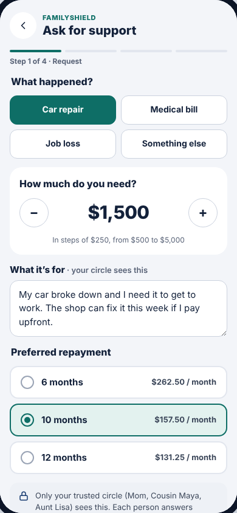

# Step 1 · Request ("Ask for support")

The borrower describes what happened, how much they need and how they'd like
to repay, then sends it to their trusted circle.

**Drawn by:** `packages/sdk/src/ui/screens/Request.tsx` (component `Request`).

 

## What's on it → where it comes from

| Part | Code (in `Request.tsx`) | Data / rule |
| --- | --- | --- |
| Step bar "Step 1 of 4 · Request" | `<Screen … step={1}>` | Step names in `STEP_LABELS`, `packages/sdk/src/ui/kit.tsx` |
| **What happened?** chips (Car repair, Medical bill…) | the `REASONS` list at the top of the file | Each reason also has a `template`, the text pre-filled in "What it's for" |
| **How much do you need?** − $1,500 + | the `fs-stepper` block | `min_request`, `max_request`, `request_step` in `data/settings.csv` |
| "In steps of $250, from $500 to $5,000" | below the stepper | same settings |
| **What it's for** text box | `<textarea id="fs-purpose">` | Pre-filled from `REASONS`; once the user types, it stops changing |
| **Preferred repayment** (6 / 10 / 12 months, $/month) | `rules.terms.map(...)` | `terms_months` in `settings.csv`. The monthly amount **includes the fee**: `estimateMonthly()` in `packages/core/src/selectors.ts` |
| Grey privacy note with the fee | `<Notice>` | `fee_rate_percent` in `settings.csv`; `feeFor()` in `packages/core/src/config.ts` |
| **Send to my trusted circle** | `send()` | see below |

## What "Send" does

1. `api.createRequest({ reason, purpose, amount, months })`
2. → `createRequest` in `packages/service/src/service.ts`: refuses if you
   already have an open request, then asks the rules to create one.
3. → `createLoanCase` in `packages/core/src/loan.ts`: checks the amount and
   term against the settings and creates one *pending* offer per circle member.
4. → saved as a new row in `loans.csv`, plus one row per family member in `offers.csv`.
5. The screen switches to [Offers](offers.md). Relatives listed in
   `data/auto_replies.csv` answer by themselves a few seconds later.

If a check fails (say, an amount out of range), the error message from
`loan.ts` appears in a red box at the top of the screen.

## Common changes

- **Add a reason** (e.g. "Home repair"):
  1. Add `{ id: 'home', label: 'Home repair', template: '…' }` to `REASONS` in `Request.tsx`.
  2. Add `'home'` to the `Reason` type in `packages/core/src/types.ts`.
  3. Add `'home'` to `REASONS` in `packages/core/src/loan.ts` and in `packages/service/src/database.ts`.
  4. Add a label for lenders in `REASON_LABEL` in `packages/sdk/src/ui/screens/Lender.tsx`.
  5. Run `npm run check`. Type errors will point at anything you missed.
- **Change the default amount ($1,500) or term (10 months):** the two
  `useState(...)` lines near the top of `Request`.
- **Change limits, step or terms:** `data/settings.csv`, no code.
- **Reword the privacy note:** the text inside `<Notice>`.
