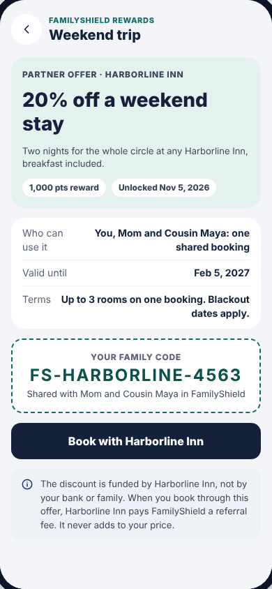

# Partner reward

One partner offer the family unlocked, after it was claimed. Before claiming,
the dashed code box is replaced by a **Claim offer for my family** button.

**Drawn by:** `packages/sdk/src/ui/screens/Reward.tsx` (component `Reward`).
**Opened from:** **View offer** on [Repay & earn](repay.md).

 

## What's on it → where it comes from

Almost everything on this screen is a column of `data/rewards.csv`:

| Part | `rewards.csv` column |
| --- | --- |
| Header ("Weekend trip") | `name` |
| "PARTNER OFFER · HARBORLINE INN" | `partner` |
| "20% off a weekend stay" | `headline` |
| Description under it | `detail` |
| "1,000 pts reward" | `points_needed` |
| Terms row | `terms` |
| "Valid until" | repaid date + `valid_for_months` |

| Part | Code |
| --- | --- |
| "Who can use it: You, Mom and Cousin Maya" | built from the loan's lenders in `Reward.tsx` |
| Family code `FS-HARBORLINE-4563` | made in `claimReward` in `packages/service/src/service.ts` (partner's first word + 4 random digits); saved in `claimed_rewards.csv` |
| Grey note about who pays for the discount | `<Notice>` at the bottom of `Reward.tsx` |
| **Book with Harborline Inn** | a placeholder button; it doesn't go anywhere yet |

## Common changes

- **Add or change a reward:** edit `data/rewards.csv`. No code. See
  [Recipes](../05-recipes.md#add-a-reward).
- **Change the code format:** `claimReward` in `packages/service/src/service.ts`.
- **Make "Book with…" open a website:** add a `url` column to `rewards.csv`,
  read it in `readRewards` (`packages/service/src/database.ts`), add `url` to
  the `Reward` type (`packages/core/src/rewards.ts`), then render
  `<a className="fs-btn dark" href={reward.url}>` in `Reward.tsx`. This is a
  good first "full-stack" change; [Data and back-end](../04-data-and-backend.md#adding-a-column)
  walks through the pattern.
