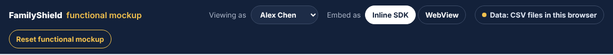

# Functional mockup bar

The dark bar at the top of the page. It's a **testing tool**, not part of the
bank or of FamilyShield. A real bank would never show it.

**Drawn by:** `apps/demo-bank/src/App.tsx` (the `<header className="demo-bar">`
block inside `App`). Styles: `.demo-bar`, `.seg`, `.data-chip`, `.reset` in
`apps/demo-bank/src/styles.css`.

## What's on it

| Part | What it does | Code | Data |
| --- | --- | --- | --- |
| **FamilyShield functional mockup** | Title | `App.tsx`, `demo-brand` | — |
| **Viewing as** | Pretend to be someone else. The whole page reloads as that person | `<select>` in `App.tsx`; the list comes from `host.people()` | Everyone in `data/people.csv` |
| **Embed as: Inline SDK / WebView** | Two ways a bank can embed FamilyShield. Same screens, different plumbing | `switchMode` in `App.tsx`; the two ways are in `FamilyShieldSheet.tsx` | — |
| **Data: CSV files via server / in this browser** | Shows where data lives; click it for details and (in browser mode) CSV downloads | `data-chip` in `App.tsx`; the pop-up is `apps/demo-bank/src/CsvPanel.tsx` | — |
| **Reset functional mockup** | Throw away all activity and start from the shared starting state | `host.reset()` | Copies `data/*.csv` activity files over `data/local/` |
| Story steps on the right | The "Try the whole story" instructions | `<aside className="notes">` in `App.tsx` | — |

## Common changes

- **Rename the bar's title or button:** edit the text in `App.tsx`. Search for
  `functional mockup`.
- **Add a person to "Viewing as":** add a row to `data/people.csv` (and to
  `data/circles.csv` so they have family). No code needed. See
  [Recipes](../05-recipes.md#add-a-person).
- **Change the story instructions:** edit the `<ol>` list in the `notes` aside in `App.tsx`.

## How "Viewing as" and "Data" work

`apps/demo-bank/src/host.ts` decides where data lives:

- With `npm run dev`, it talks to the server (`createServerMockup`). The server
  reads `data/` and writes to `data/local/`.
- On GitHub Pages or `npm run dev:browser`, it runs the back-end inside the
  browser (`createBrowserMockup`), starting from the CSV files bundled by
  `apps/demo-bank/src/seedCsv.ts`.

Both are in `packages/sdk/src/mockup/`.
